<!--
  Profile README for github.com/agrawal-ashwin
  Banner and divider are stored in /assets, so they never break.
  Lines marked TODO are placeholders. Fill them with real links when ready,
  or delete them. Nothing here is made up, so please keep it that way.
-->

  

  
  <!-- TODO: uncomment and add your real links
  
  
  -->

  I take everyday problems, from clinic queues to crop data, and turn them into working software. 
  My focus is on two things: making sense of data, and keeping systems safe.

## About me

<table>
  <tr>
    <td width="50%" valign="top">
      <h3>On the data side</h3>
      I like cleaning messy data, finding what it is actually saying and putting it into a chart or dashboard that anyone can read in a few seconds. Mostly I work with Python, SQL, Excel and Power BI.
    </td>
    <td width="50%" valign="top">
      <h3>On the security side</h3>
      I am learning how systems get attacked so that I can protect them better. Right now my focus is on networking basics, Linux and doing hands-on security labs.
    </td>
  </tr>
</table>

I also do full-stack work with **Next.js** and **TypeScript**, so I can build the app that sits on top of the data, not just the analysis part.

## Tech stack

  

<table align="center">
  <tr>
    <td><b>Data</b></td>
    <td>
      
      
      
      
      
    </td>
  </tr>
  <tr>
    <td><b>Security</b></td>
    <td>
      
      
      <!-- TODO: add the exact security tools you use, for example:
      
      -->
    </td>
  </tr>
  <tr>
    <td><b>Web</b></td>
    <td>
      
      
    </td>
  </tr>
</table>

## What I build

<table>
  <tr>
    <td width="50%" valign="top">
      <h3>Data analytics</h3>
      Dashboards, exploratory analysis and reports built from real datasets.  
      <!-- TODO: link your best analysis repo, e.g. - <a href="https://github.com/agrawal-ashwin/REPO">Sales dashboard (Power BI)</a> -->
      <i>Repos are being uploaded. Check back soon.</i>
    </td>
    <td width="50%" valign="top">
      <h3>Cybersecurity</h3>
      Security labs, network analysis and notes from hands-on practice.  
      <!-- TODO: link your security repo, e.g. - <a href="https://github.com/agrawal-ashwin/REPO">Home lab write-ups</a> -->
      <i>Repos are being uploaded. Check back soon.</i>
    </td>
  </tr>
</table>

### Featured projects

<!--
  TODO: when the repos are public, replace each "Coming soon" with a real link
  and the real tech stack. Copy a <td> block to add more projects.
-->
<table>
  <tr>
    <td width="50%" valign="top">
      <h4>Clinic Queue System</h4>
      Software to manage patient queues at clinics, so people wait less and staff know who is next.  
      <code>Next.js</code> <code>TypeScript</code>  
      <b>Repo:</b> coming soon
    </td>
    <td width="50%" valign="top">
      <h4>Crop Data Analysis</h4>
      Working with crop data to find useful patterns and show them in a simple way.  
      <code>Python</code> <code>Data analysis</code>  
      <b>Repo:</b> coming soon
    </td>
  </tr>
</table>

## GitHub stats

  
  

  

  <picture>
    <source media="(prefers-color-scheme: dark)" srcset="https://raw.githubusercontent.com/agrawal-ashwin/agrawal-ashwin/output/snake-dark.svg" />
    <source media="(prefers-color-scheme: light)" srcset="https://raw.githubusercontent.com/agrawal-ashwin/agrawal-ashwin/output/snake.svg" />
    
  </picture>

Stats come from outside services. If a card does not load, just refresh, the rest of the page still works.

## Currently learning

- Going deeper into **SQL** for analysis, like window functions and CTEs
- Building cleaner **Power BI** dashboards and better data stories
- **Network security** basics and traffic analysis
- More **Linux** for day-to-day security work

## Let's connect

Open to internships, freelance data work and small security projects. If you have a dataset that needs some sense made of it, or a system you want checked, feel free to reach out.

  

